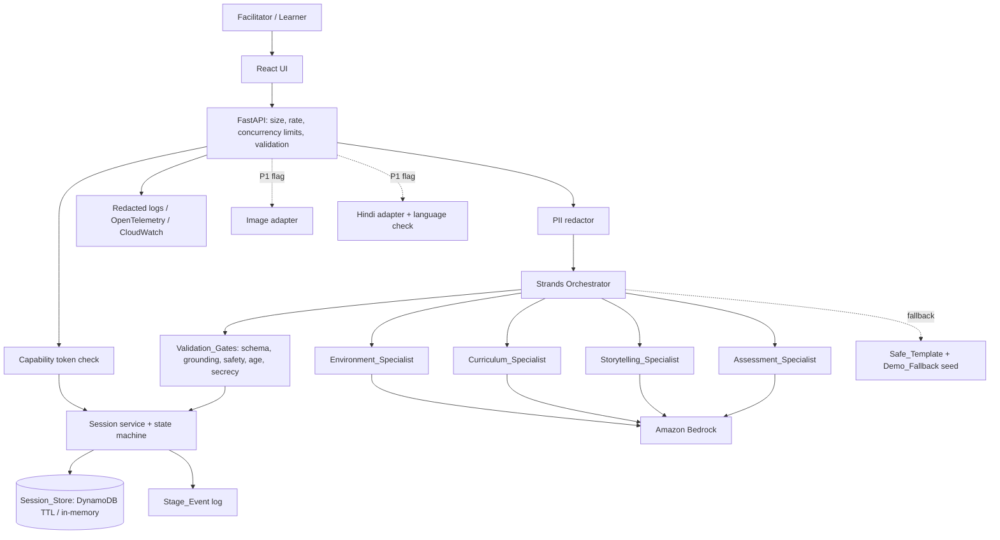
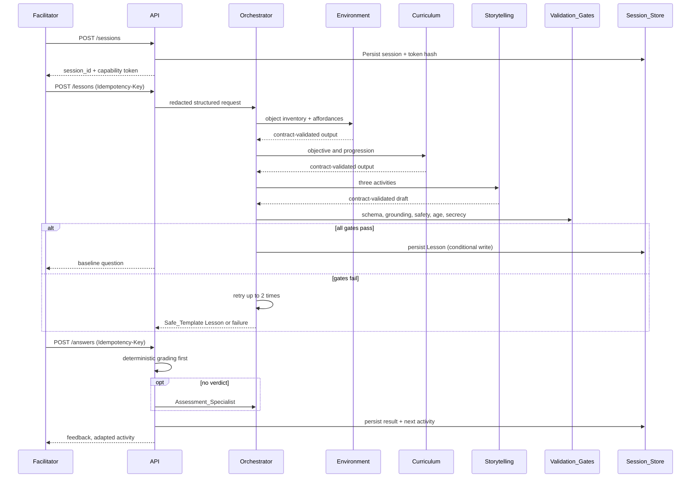
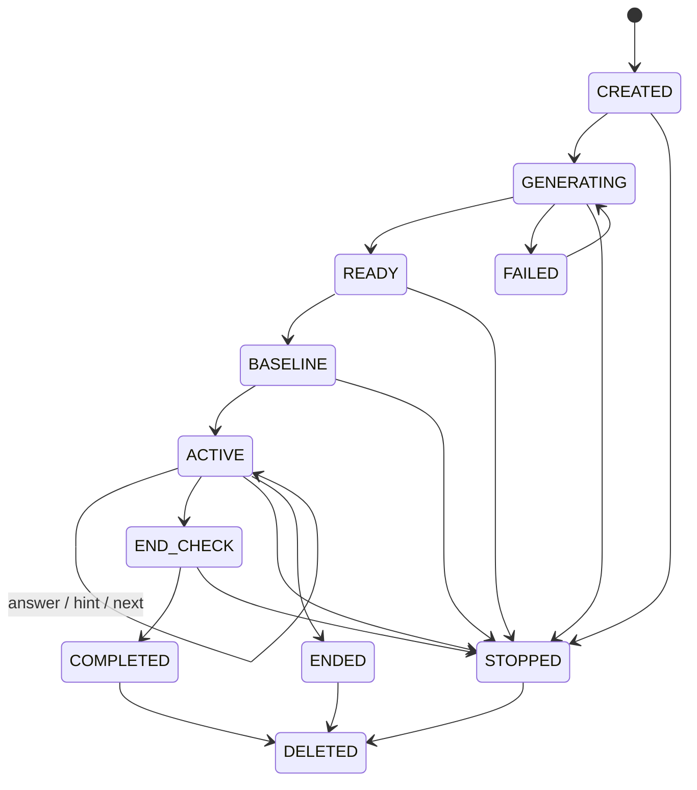

# Design Document: The Invisible Classroom

## Overview

The Invisible Classroom turns household objects into short, safe, age-appropriate learning adventures. An adult Facilitator enters an Age_Band, a Subject and 1 to 20 Objects. A Strands Agents SDK orchestrator coordinates four specialist agents (Environment, Curriculum, Storytelling, Assessment) running on Amazon Bedrock. Deterministic Validation_Gates, not LLMs, decide whether a Lesson is displayed. The Learner solves one Activity at a time, gets rubric-based feedback and an adapted next challenge, and the Facilitator can stop or delete the Session at any time.

This design is based on the approved `requirements.md` and the source technical design at the workspace root (`design.md`). Where they differ, the requirements win. Reconciliations are listed below.

### Key design decisions

| Decision | Rationale |
|---|---|
| Modular monolith (FastAPI) plus React/TypeScript SPA | One deployable, simple ops, enough for MVP scale. Microservices add cost without benefit (NFR-05, NFR-07). |
| Strands agents-as-tools with Pydantic structured output | Typed handoffs make Specialist_Contract validation (R-04.3) mechanical. |
| Validation_Gates are plain Python outside the LLMs | Models are untrusted (NFR-10). Safety, grounding and arithmetic must be deterministic (R-06.5, R-08). |
| Server-owned state with optimistic concurrency | Conditional writes enforce legal state transitions and idempotency under retries. |
| DynamoDB with TTL; in-memory repository for local dev | Matches R-10 and keeps tests fast. |
| Capability token (bearer, hash stored) | No child accounts (R-01.4); possession of token is authorization. |
| P1 features (image, Hindi) are optional adapters behind feature flags | Keeps them off the P0 path (Traceability 3, R-15.3). |

### Reconciliation of source design with approved requirements

| Topic | Source design | Approved requirement (used here) |
|---|---|---|
| Object limit | 12 available objects | Inventory 1 to 20 unique, name at most 50 chars (R-02.1). Lesson object list 1 to 10 (R-03.1). |
| Lesson field limits | title 120, objective 250, instruction 600, hint single | title 80, objective 200, setup 500, instruction 300, 1 to 3 hints, 5 to 10 minutes (R-03.1, R-03.2). |
| Explanation length | 450 chars | At most 300 chars (R-06.1). |
| Stop control | `/end` only | Add `POST /sessions/{id}/stop` with 2 s effect (R-08.3). `/end` remains for normal completion. |
| Generation limits | 8 calls, 45 s, 15 s | Also depth 2, 2 retries per specialist call, 20,000 tokens (R-04.4). All configurable. |
| Idempotency | key on mutations | 24 h window; same key with different payload returns conflict (R-11.2, R-11.7). |
| Request limits | unspecified | 1 MB body, 50 concurrent, 60 req/min per client (R-11.4). |
| Spelling | not covered | Up to 2 character edits per word when spelling is not the objective (R-09.9). |
| Demo preset | not specified | Age_Band 6-8, mathematics, exactly seven Objects: five stones and two leaves (R-12.1). The seed file is the single source of truth. |
| Session storage | limited list | Also stores Capability_Token hash, state version and idempotency records (R-10.1). |

## Architecture



### Runtime and hosting

- Frontend: React/TypeScript SPA, served from S3/CloudFront or the container.
- Backend: FastAPI in a container (App Runner or ECS Fargate, subject to account support). Pydantic v2 for all contracts.
- Persistence: DynamoDB table with TTL attribute `expires_at`. In-memory repository for local development and tests.
- Models: Bedrock, with model ID and region from configuration (NFR-07). Deterministic model stubs for tests and local mode.
- Mock or fallback output is always labeled and never presented as live agent execution (R-12.4, G5).

### Orchestration flow



### Session state machine



`STOPPED` is added to the source machine to satisfy R-08.3: after Stop, answer, hint and advance requests return a stopped-session error, while read and delete remain allowed. Every transition is a DynamoDB conditional write on `version`.

### Limits and budgets

All values are configuration with these defaults (R-04.4, R-11.4, NFR-07).

| Limit | Default |
|---|---|
| Orchestration depth | 2 |
| Specialist calls per request | 8 |
| Generation deadline / assessment deadline | 45 s / 15 s |
| Retries per specialist call | 2 |
| Lesson generation retries after gate failure | 2 |
| Model tokens per request | 20,000 |
| Request body | 1 MB |
| Concurrent in-flight requests | 50 |
| Per-client rate | 60 per minute |
| Idempotency window | 24 h |
| Session TTL | 24 h from last update |
| Demo fallback trigger | Bedrock unavailable or no response in 10 s |
| Stage_Event exposure latency | within 1 s |

A shared `RequestBudget` object tracks depth, calls, tokens and deadline. Any specialist invocation first calls `budget.consume()`, which raises `LimitReached(limit_name)`. The orchestrator then stops, emits a failed Stage_Event and returns an error naming the limit (R-04.7).

## Components and Interfaces

### Backend modules

```text
backend/app/
  main.py                      # app factory, middleware wiring
  api/routes/                  # sessions, lessons, answers, hints, stop, events, health
  api/middleware.py            # body size, concurrency cap, rate limit, correlation ID
  api/auth.py                  # capability token dependency
  api/errors.py                # ApiError mapping
  domain/models.py             # Pydantic contracts
  domain/state_machine.py      # legal transitions
  agents/{orchestrator,environment,curriculum,storytelling,assessment}.py
  agents/budget.py             # RequestBudget
  services/session_service.py
  services/lesson_service.py
  services/assessment_service.py
  services/grading.py          # deterministic grading + spelling tolerance
  services/normalizer.py       # object normalization and dedupe
  services/safety.py           # hazard + secrecy/dependence gates
  services/grounding.py        # inventory subset check
  services/age_vocab.py        # Age_Band vocabulary and concept rules
  services/pii.py              # detect and redact
  services/idempotency.py
  services/readability.py     # instruction length and reading level check
  adapters/bedrock.py
  adapters/session_store.py    # DynamoDB + in-memory implementations
  adapters/image_analysis.py   # P1, feature flag
  adapters/hindi.py            # P1, feature flag, includes language check
  templates/safe_lessons/      # Safe_Template Lessons
  templates/demo_seed/         # Demo_Fallback seed data
  observability/               # redaction, spans, metrics
```

Dependencies (model client, store, clock, id generator) are injected so tests can substitute them.

### API surface

Prefix `/api/v1`. All session routes require `Authorization: Bearer <capability token>`. Mutations accept an `Idempotency-Key` header.

| Method | Endpoint | Purpose | Requirements |
|---|---|---|---|
| POST | `/sessions` | Validate, create Session, return Session_ID and token (within 2 s) | R-01, R-02, R-08.6 |
| POST | `/sessions/{id}/lessons` | Start idempotent generation; 202 plus job status | R-03, R-04, R-11.2 |
| GET | `/sessions/{id}` | Learner-view state, active Activity, progress | R-03.6, R-05.1, R-10.8 |
| GET | `/sessions/{id}/events` | Poll Stage_Events (SSE optional) | R-04.5, R-12.2 |
| POST | `/sessions/{id}/baseline` | Answer or skip Baseline_Question | R-07.1, R-07.6 |
| POST | `/sessions/{id}/answers` | Idempotent answer submission | R-05.2 to R-05.4, R-06 |
| POST | `/sessions/{id}/hint` | Scaffold hint, no status change | R-05.5 |
| POST | `/sessions/{id}/advance` | Complete or skip Activity, persist and advance | R-05.6, R-05.7 |
| POST | `/sessions/{id}/end-check` | Answer or skip End_Question | R-07.2 to R-07.5 |
| POST | `/sessions/{id}/stop` | Stop within 2 s, cancel pending calls | R-08.3 |
| POST | `/sessions/{id}/end` | Normal end, enables delete action | R-10.4 |
| DELETE | `/sessions/{id}` | Permanent delete, confirm within 2 s | R-10.5, R-10.6 |
| GET | `/sessions/{id}/summary` | Concepts practiced, next steps, provisional estimate | R-05.8, R-06.6 |
| POST | `/demo/session` | Create Demo_Mode session from preset | R-12.1 |
| GET | `/healthz` | Liveness, no external calls, 500 ms | R-11.5 |
| GET | `/readyz` | Dependency readiness, 2 s | R-11.6 |
| POST | `/sessions/{id}/images` | P1 image analysis (flag) | R-13 |

Error responses: `{code, message, correlation_id, details?}` with no raw exception or prompt text. Status mapping: 404 not found or deleted, 410 expired, 409 invalid state, stopped session or idempotency key conflict (distinct `code`), 413 body too large, 422 validation (lists each invalid field), 429 rate or concurrency exceeded (code names which limit), 503 dependency unavailable. Limit rejections occur in middleware before any handler, so they have no side effects (R-11.4).

### Key component contracts

```python
class Orchestrator(Protocol):
    async def generate_lesson(self, req: LessonRequest, budget: RequestBudget,
                              emit: StageEmitter) -> Lesson: ...
    async def assess(self, req: AssessRequest, budget: RequestBudget,
                     emit: StageEmitter) -> Assessment: ...

class ValidationGates(Protocol):
    def check_lesson(self, lesson: Lesson, inv: ObjectInventory,
                     age: AgeBand, subject: Subject) -> GateResult: ...
    def check_activity(self, a: Activity, inv: ObjectInventory) -> GateResult: ...

class SessionStore(Protocol):
    def create(self, s: SessionRecord) -> None: ...
    def get(self, session_id: str, now: datetime) -> SessionRecord: ...   # raises NotFound / Expired
    def put_if_version(self, s: SessionRecord, expected: int) -> None: ... # conditional write
    def delete(self, session_id: str) -> None: ...

class Grader(Protocol):
    def grade(self, activity: Activity, answer: str, spelling_matters: bool) -> Grade | None: ...
    # None means "no deterministic verdict", so the Assessment_Specialist is invoked.
```

Component behaviors:

- **Normalizer**: trim, collapse internal whitespace, case-insensitive comparison, dedupe on normalized key, keep original text of the first occurrence, enforce 1 to 20 unique and 50 chars (R-02.1, R-02.2).
- **PII redactor**: detects names, phone, email, street address, school name, birth date patterns. If redaction succeeds, the redacted text goes to models and the Facilitator sees a warning. If it cannot be redacted, nothing is sent to any model and an error asks the Facilitator to remove it (R-08.6, R-08.7).
- **Orchestrator**: calls Environment, Curriculum and Storytelling in order, validating each output against its versioned Specialist_Contract and recording the contract version in the Stage_Event. It retries a failing specialist up to the retry limit. After final failure it returns an error naming the specialist and persists nothing (R-04.3, R-04.6).
- **Validation_Gates**: pure functions. Schema (Pydantic plus length rules), grounding (every `required_objects` item in the inventory, no purchased supplies), safety (hazard taxonomy: ingestion, sharp, fire, electricity, hazardous chemicals, heights, strangers, dangerous water), secrecy and emotional dependence, age vocabulary, and unique activity IDs. A single hazardous Activity rejects the whole Lesson and counts as a failed attempt (R-08.2).
- **Lesson service**: loop of up to 1 initial plus 2 retries; on exhaustion returns the Safe_Template for the Age_Band and Subject (labeled) or a failure with no Lesson (R-03.4, R-03.5). Model failure or timeout cancels the call and, within 2 s, returns an error with retry and Safe_Template options (R-11.1).
- **Grader**: exact arithmetic and counting answers are parsed to numbers and compared deterministically. Text answers use word-level edit distance of at most 2 per word when `spelling_matters` is false (R-09.9). Returns `None` only when no deterministic verdict exists, which triggers the Assessment_Specialist (R-04.2, R-06.5). Ambiguous answers produce `unassessable` with a clarification request. After 2 failed clarifications the answer is excluded from mastery estimates and skip or hint is offered (R-06.3, R-06.4).
- **Adaptation**: when a misconception is flagged, the next Activity keeps the same objective but changes scaffold level or difficulty, and the adjustment is reported to the Facilitator (R-06.2). The adapted Activity passes the same gates.
- **Learner view projector**: removes `expected_answer`, `rubric` and `facilitator_note` from responses until an answer is submitted, then includes the expected answer and rubric for that Activity only. Facilitator notes are served only through the facilitator view of the same token-authenticated session, never in the learner payload (R-03.2, R-03.6, R-03.7).
- **Stage emitter**: writes a Stage_Event `{stage, specialist, status, contract_version?, timestamp}` for start, complete and fail. Events contain no prompts, reasoning, credentials or internal IDs (R-04.5, R-12.3). The Demo_Mode five-stage display maps events onto: understand objects, choose objective, create story, assess answer, adapt next activity.
- **Demo_Fallback**: if Bedrock is unavailable or silent for 10 s, play pre-recorded seed data through the same five stages. Every stage screen shows `Demo fallback — no live agent execution` (R-12.4).
- **Image adapter (P1)**: validates JPEG or PNG at most 5 MB before analysis, returns at most 20 objects within 15 s, forbids person inference, deletes the image on confirmation, session end, or 24 h. Generation is blocked until at least one object is confirmed (R-13).
- **Hindi adapter (P1)**: generates Devanagari instructions, then runs a language check (script, preserved numbers, units and object names, non-empty) within 5 s. On failure it shows the English Lesson with a notice and a retry action, and never shows unchecked Hindi (R-14).

### Frontend structure

```text
frontend/src/{app,api,components,features,types}/
  features/setup        # age, subject, objects, demo preset, validation errors
  features/timeline     # five sanitized stages, fallback label
  features/baseline     # baseline/end question with skip
  features/activity     # one Activity, progress "n of N", hint, answer, feedback
  features/summary      # concepts, next steps, difference with not-validated warning
  features/session      # stop, end, delete, supervision notice
```

TypeScript types are generated from the FastAPI OpenAPI schema. Model text is rendered only through escaped React text nodes with a strict CSP. UI rules: adult-supervision notice on every Lesson screen (R-08.4), instruction text at most 3 sentences of at most 25 words, no timed answers (R-09.7), 320 px reflow (R-09.5), visible focus (R-09.2), labeled controls (R-09.3), non-color/sound alternatives (R-09.8). The Web_UI retains entered values on any error (R-01.3, R-01.6, R-10.9, R-11.1). The observed difference view is shown only when both baseline and end answers exist and the difference is positive. For zero or negative differences it shows the value and warning only, and it never claims improvement (R-07.3 to R-07.5).

## Data Models

### Enumerations and core contracts (Pydantic v2)

```python
class AgeBand(str, Enum):  B6_8 = "6-8"; B9_10 = "9-10"; B11_12 = "11-12"
class Subject(str, Enum):  ARITHMETIC = "arithmetic_counting"; MEASUREMENT = "intro_measurement"
class AssessmentStatus(str, Enum):
    CORRECT = "correct"; PARTIAL = "partially_correct"
    SUPPORT = "needs_support"; UNASSESSABLE = "unassessable"

class CreateSessionRequest(BaseModel):
    age_band: AgeBand
    subject: Subject
    objects: list[constr(strip_whitespace=True, min_length=1, max_length=50)] = Field(min_length=1, max_length=20)
    language: Literal["en", "hi"] = "en"          # "hi" only honored when P1 flag is on
    model_config = ConfigDict(extra="forbid")      # rejects name, birthday, address, school, email fields

class ObjectItem(BaseModel):
    original: str = Field(max_length=50)
    normalized: str = Field(max_length=50)
    assumption: str | None = Field(default=None, max_length=100)   # visible safe assumption
    excluded_reason: str | None = None
    safe_alternative: str | None = None

class ObjectInventory(BaseModel):
    items: list[ObjectItem] = Field(min_length=1, max_length=20)

class Activity(BaseModel):
    id: str
    instruction: str = Field(min_length=1, max_length=300)       # learner-facing
    facilitator_note: str = Field(max_length=600)                # separate field
    required_objects: list[str] = Field(max_length=10)
    answer_kind: Literal["integer", "decimal", "short_text", "choice"]
    expected_answer: str = Field(max_length=250)
    rubric: str = Field(max_length=500)
    hints: list[str] = Field(min_length=1, max_length=3)
    difficulty: int = Field(ge=1, le=3)
    spelling_matters: bool = False
    alternatives: list[str] = []                                 # non-color/sound/fine-motor variants

class Question(BaseModel):                                       # baseline and end
    id: str
    topic: str
    prompt: str = Field(max_length=300)
    scale_max: int = Field(ge=1, le=10)                          # same answer scale for both

class Lesson(BaseModel):
    schema_version: str = "1.0"
    source: Literal["generated", "safe_template", "demo_fallback"]
    title: str = Field(min_length=1, max_length=80)
    objective: str = Field(min_length=1, max_length=200)
    objects: list[str] = Field(min_length=1, max_length=10)
    setup: str = Field(min_length=1, max_length=500)
    activities: list[Activity] = Field(min_length=3, max_length=3)
    baseline_question: Question
    end_question: Question
    estimated_minutes: int = Field(ge=5, le=10)

class Assessment(BaseModel):
    status: AssessmentStatus
    explanation: str = Field(max_length=300)
    misconception: str | None = Field(default=None, max_length=250)
    suggested_scaffold: str | None = Field(default=None, max_length=350)
    confidence: float = Field(ge=0, le=1)
    adjustment_note: str | None = None                           # shown to Facilitator
```

Other models: `LessonRequest`, `CurriculumPlan`, `AnswerRequest` (answer 1 to 2,000 chars), `AgentStageEvent`, `SessionSummary`, `ApiError`, `GateResult(passed, reasons[])`, `Grade`. Specialist outputs (`EnvironmentOutput`, `CurriculumPlan`, `StoryDraft`, `AssessmentOutput`) each carry `contract_version`. Validators additionally enforce unique Activity IDs, `required_objects` subset of the inventory, `objects` subset of the submitted inputs, and legal state transitions.

### Persisted session record

DynamoDB table `InvisibleClassroomSessions`, partition key `session_id` (random, at least 128 bits, from `secrets.token_urlsafe(32)`, not derived from any input).

| Attribute | Notes |
|---|---|
| `session_id` | PK, opaque |
| `token_hash` | hash of the Capability_Token; compared in constant time |
| `state` | state machine value |
| `age_band`, `subject`, `language` | |
| `objects` | original and normalized entries |
| `lesson` | approved Lesson only; never a partial one |
| `activity_status[]` | pending, completed, skipped, plus attempts and clarification counts |
| `answers[]` | stored as session data; never logged |
| `baseline`, `end_answer` | integers or skipped marker |
| `current_index` | |
| `stage_events[]` | sanitized |
| `idempotency[]` | `{key, route, payload_hash, result_ref, created_at}` retained 24 h |
| `generation_count` | caps generations per session (default 2) |
| `created_at`, `updated_at`, `expires_at` | `expires_at = updated_at + 24 h`, refreshed on every persist |
| `version` | optimistic concurrency counter |

Nothing else is stored: no child name, birthday, address, school, email, no cross-session link, no raw images (R-10.1, R-10.2). Reads compare `expires_at` to the clock and reject expired sessions before TTL removal (R-10.8).

### Idempotency handling

Within a mutation, compute `payload_hash`. Look up the key in the session's records within 24 h. Same key and hash returns the stored result with no re-execution. Same key with a different hash returns a key-conflict error and changes nothing (R-11.2, R-11.7). A new key executes, then stores the record in the same conditional write as the state change, so the mutation is applied exactly once (R-05.3).

### Threat model summary

| Risk | Control |
|---|---|
| Unsafe activities | Hazard taxonomy gate rejects the whole Lesson, curated Safe_Templates, adult supervision notice |
| Prompt injection | Object text and answers treated as data, narrow prompts, specialists get no shell, browser or write tools, outputs validated |
| Hallucinated resources | Deterministic subset check against inventory |
| Child privacy | PII redaction before models, no raw answers in logs, 24 h TTL, explicit delete |
| Session theft | 128-bit+ token, hashed storage, TLS, throttling |
| XSS from model text | Escaped rendering, CSP |
| Runaway cost | RequestBudget, concurrency and rate caps, per-session generation cap |
| Supply chain and secrets | IAM runtime role with least privilege, pinned lockfiles, SBOM, vulnerability and secret scans |
| Unsubstantiated claims | Provisional labels and not-validated warning, no diagnosis language (R-06.6, NFR-09) |

The design draws on AWS Well-Architected, OWASP ASVS and LLM Top 10, privacy by design and WCAG 2.2 AA as engineering guidance, not certification claims.

## Correctness Properties

*A property is a characteristic or behavior that should hold true across all valid executions of a system-essentially, a formal statement about what the system should do. Properties serve as the bridge between human-readable specifications and machine-verifiable correctness guarantees.*

Reflection merged overlapping candidates: input validation (1.3, 2.2), learner-view projection (3.6, 3.7), budgets (4.4, 4.7), idempotency (5.3, 11.2, 11.7), safety gate (2.4, 8.2, 8.5), grounding (2.5, 2.6), delete (10.5, 10.6), expiry (10.7, 10.8) and baseline/end display (7.3 to 7.5).

### Property 1: Session identifiers are unique and input-independent

For any set of valid session requests, every created Session_ID is distinct, carries at least 128 bits of randomness, and is not a function of the submitted fields (creating twice with identical inputs yields different IDs).

**Validates: Requirements 1.2**

### Property 2: Invalid input is rejected with no side effects

For any session request that violates a rule (age or subject missing, zero objects, more than 20 objects, any object over 50 characters, or an extra identity field), the API rejects it, names every invalid field, creates no Session and makes zero model calls.

**Validates: Requirements 1.3, 1.4, 2.2**

### Property 3: Object normalization is canonical and lossless

For any list of 1 to 20 object strings, the Object_Inventory contains no two items equal after trim, whitespace collapse and case folding, keeps the original text of each retained item unchanged, and normalizing an already normalized inventory yields the same inventory.

**Validates: Requirements 2.1**

### Property 4: Lesson schema bounds are enforced

For any candidate Lesson, the validator accepts it if and only if it has a title of 1 to 80 characters, an objective of 1 to 200, 1 to 10 objects, a setup of 1 to 500, exactly three Activities with instructions of 1 to 300 characters and 1 to 3 hints each, and a duration of 5 to 10 minutes.

**Validates: Requirements 3.1, 3.2**

### Property 5: Grounding gate matches the inventory

For any Lesson and Object_Inventory, the grounding gate passes if and only if every object referenced by every Activity and the Lesson object list is in the inventory and no Activity requires purchased supplies; a failing Activity is never present in any learner view.

**Validates: Requirements 2.5, 2.6, 3.1**

### Property 6: Safety gate rejects the whole Lesson

For any otherwise valid Lesson into which a hazard concept (ingestion, sharp objects, fire, electricity, hazardous chemicals, heights, strangers, dangerous water) or a secrecy or emotional-dependence phrase is injected into any learner or facilitator field of any Activity, the gates reject the entire Lesson and count it as a failed attempt.

**Validates: Requirements 2.4, 8.1, 8.2, 8.5**

### Property 7: Bounded retry then safe fallback

For any sequence of generation attempt outcomes, the lesson service makes at most 3 generation attempts; it returns the generated Lesson if one of them passes, otherwise the labeled Safe_Template if one exists for the Age_Band and Subject, otherwise a failure with no Lesson persisted.

**Validates: Requirements 3.4, 3.5**

### Property 8: Learner view never leaks answers early

For any session state, the serialized learner view contains no expected answer, full rubric or facilitator note for any Activity without a submitted answer; after an answer is submitted the view contains the expected answer and rubric for that Activity only.

**Validates: Requirements 3.2, 3.6, 3.7**

### Property 9: Invalid specialist output is never persisted

For any specialist output that fails its Specialist_Contract, the orchestrator retries at most the configured retry limit, then returns an error naming the specialist, and the Session_Store contains no partial Lesson or assessment.

**Validates: Requirements 4.3, 4.6**

### Property 10: Request budgets are never exceeded

For any configured limits and any sequence of specialist invocations, the number of calls, depth and tokens consumed never exceed their limits, and the first call that would exceed a limit raises an error naming that limit and produces a failed Stage_Event.

**Validates: Requirements 4.4, 4.7**

### Property 11: Stage events are well-formed and sanitized

For any orchestration run, including runs with injected failures, each stage emits a `started` event followed by exactly one `completed` or `failed` event, each with stage, specialist, status and timestamp, and no event contains prompt text, credentials or internal identifiers.

**Validates: Requirements 4.5, 12.3**

### Property 12: Mutations are idempotent within the window

For any mutation request and any number n of repeats with the same Idempotency_Key and payload within 24 hours, the resulting session state equals the state after one application and every repeat returns the original result; for any repeat with the same key and a different payload, the API returns a key-conflict error and stored results are unchanged.

**Validates: Requirements 5.3, 11.2, 11.7**

### Property 13: Invalid answers and hints leave progress unchanged

For any answer that is empty, longer than 2,000 characters or does not match the Activity's answer format, the API rejects it and the Activity status and progress are unchanged; for any hint request the Activity status is unchanged and the hint does not contain the expected answer text.

**Validates: Requirements 5.4, 5.5**

### Property 14: Exact answers are graded deterministically

For any arithmetic Activity and any numeric answer, grading returns `correct` if and only if the parsed value equals the expected value, the same input always yields the same result, and no model call is made.

**Validates: Requirements 5.2, 6.5**

### Property 15: Assessment output is well-formed

For any answer, the System returns exactly one Assessment_Status from the allowed set with an explanation of at most 300 characters, and any mastery estimate is labeled provisional and contains no diagnostic language.

**Validates: Requirements 6.1, 6.6**

### Property 16: Adaptation preserves the objective

For any Lesson and any detected misconception, the adapted next Activity has the same learning objective, a different scaffold level or difficulty, passes all Validation_Gates, and the adjustment is reported to the Facilitator.

**Validates: Requirements 6.2**

### Property 17: Unclear answers are never marked wrong and are eventually excluded

For any ambiguous answer, the status is `unassessable` and no incorrect mark is recorded; after 2 failed clarification attempts the answer is excluded from mastery estimates and skip and hint are offered.

**Validates: Requirements 6.3, 6.4**

### Property 18: Spelling tolerance applies only when spelling is not the objective

For any accepted answer and any variant that differs in each word by at most 2 character edits, grading marks it correct when `spelling_matters` is false and gives the same score as the exact answer; when `spelling_matters` is true the tolerance is not applied.

**Validates: Requirements 9.9**

### Property 19: Observed difference is shown only when valid

For any combination of baseline and end answers or skips, the observed difference (end minus baseline) is displayed only when both were answered, always with the not-validated warning, and no improvement statement is shown when either was skipped or the difference is zero or negative.

**Validates: Requirements 7.3, 7.4, 7.5**

### Property 20: State machine permits only legal transitions

For any sequence of events applied to a Session, the state is always reachable through the defined transitions, and after Stop every answer, hint and advance request is rejected with a stopped-session error while read and delete remain allowed.

**Validates: Requirements 8.3**

### Property 21: PII never reaches a model

For any input containing a detectable name, phone number, email, street address, school name or birth date, the text sent to the model stub contains none of it and a warning is returned; if redaction cannot be completed, no model call is made.

**Validates: Requirements 8.6, 8.7**

### Property 22: Instruction text respects readability limits

For any Activity instruction accepted by the readability check, it has at most 3 sentences, each of at most 25 words; any instruction exceeding these limits is rejected.

**Validates: Requirements 9.6**

### Property 23: Learner free text never appears in logs

For any answer string and any request flow, captured logs and diagnostic records contain no answer text, credentials or personal data, and each record contains a correlation ID, stage statuses, latency and, on error, an error category.

**Validates: Requirements 10.3, 11.3**

### Property 24: Deleted sessions are gone

For any session, after a delete request every subsequent read or delete returns not-found with no session data, and the store holds nothing under that Session_ID.

**Validates: Requirements 10.5, 10.6**

### Property 25: Expiry is enforced on read

For any persisted session, `expires_at` equals the last-updated time plus 24 hours, and for any read at a time past `expires_at` the API returns an expired error with no session data even if TTL removal has not run.

**Validates: Requirements 10.7, 10.8**

### Property 26: Request limits reject without side effects

For any request whose body exceeds 1 MB, or that arrives when the concurrency or rate cap is exceeded, the API rejects it, names the limit exceeded, and the Session_Store is unchanged.

**Validates: Requirements 11.4**

### Property 27: Image validation (P1)

For any uploaded file, the validator accepts it if and only if it is JPEG or PNG and at most 5 MB, and a rejected image leaves session data and Objects unchanged.

**Validates: Requirements 13.1, 13.2**

### Property 28: Hindi language check (P1)

For any Hindi Lesson and its English equivalent, the language check passes if and only if all learner instructions are Devanagari, every number, unit and Object name is preserved, and no instruction is empty; on failure only the English Lesson is displayed.

**Validates: Requirements 14.3, 14.4, 14.5**

## Error Handling

| Condition | Behavior | Requirement |
|---|---|---|
| Field validation failure | 422 listing each invalid field; Web_UI keeps values; no Session, zero model calls | R-01.3 |
| Session creation infrastructure failure | Error "Session could not be started", values retained, no partial record | R-01.6 |
| PII detected / not redactable | Redact and warn / refuse model call and ask Facilitator to remove it | R-08.6, R-08.7 |
| Gate failure on generated Lesson | Discard, retry up to 2 times, then Safe_Template or failure | R-03.4, R-03.5 |
| Specialist contract failure | Retry per limit, then error naming specialist, nothing persisted | R-04.6 |
| Budget limit reached | Stop, error naming limit, failed Stage_Event | R-04.7 |
| Model error or timeout | Cancel call, within 2 s show retry and Safe_Template option, inputs kept | R-11.1 |
| Bedrock unavailable or silent for 10 s (Demo_Mode) | Demo_Fallback with visible label on every stage screen | R-12.4 |
| Invalid answer | Reject, identify the validation failure, state unchanged | R-05.4 |
| Persist failure on advance | Error shown, Learner stays on Activity, retry allowed; for session persistence a message within 2 s with retry | R-05.7, R-10.9 |
| Stopped session | 409 stopped-session error for writes | R-08.3 |
| Deleted / unknown / expired session | 404 / 404 / 410 with no data | R-10.6, R-10.8 |
| Idempotency conflict | 409 `idempotency_key_conflict`, stored results unchanged | R-11.7 |
| Optimistic write conflict | Re-read and retry once, then 409 | NFR-05 |
| Body, concurrency or rate limit exceeded | 413 / 429 naming the limit, no side effects | R-11.4 |
| Dependency down | `/readyz` returns 503 naming dependencies; `/healthz` stays 200 | R-11.5, R-11.6 |
| No accessible alternative for an Activity | Message to Learner, progress preserved, Facilitator notified | R-09.10 |
| Hindi check failure or timeout (P1) | English Lesson with notice, retry action | R-14.5, R-14.6 |
| Image rejected or no objects (P1) | Reason shown, image discarded, manual entry offered | R-13.2, R-13.4 |

All errors use the `ApiError` shape with a correlation ID. Raw exceptions, prompts and model reasoning are never returned. Model calls use timeouts, bounded retries and a circuit breaker (NFR-05).

## Testing Strategy

### Approach

Property-based testing applies to the pure and near-pure logic: normalizer, validators, gates, grader, budgets, state machine, projector, idempotency, redactor, readability and expiry. It does not apply to UI rendering, accessibility, infrastructure wiring, Bedrock behavior or the live-model output, which use example, snapshot, integration and evaluation tests instead.

- **Libraries**: Hypothesis for Python backend; fast-check for frontend logic (difference display, form validation). Property-based testing is not implemented from scratch.
- **Configuration**: each correctness property is implemented by a single property-based test, run for a minimum of 100 iterations, and tagged with a comment `Feature: invisible-classroom, Property {n}: {property text}`.
- **Models**: all property tests use deterministic model stubs. Live Bedrock is never used in properties.

### Unit and example tests

Specific examples: setup page controls and Demo_Mode preset fill (R-01.1, R-01.5); ambiguous object handling (R-02.3); Specialist invocation order (R-04.1); Assessment_Specialist invoked only when grading returns none (R-04.2); one-Activity display and "n of N" progress (R-05.1, R-05.6, R-05.8); supervision notice (R-08.4); stored session fields (R-10.1); `/healthz` and `/readyz` (R-11.5, R-11.6); Demo_Mode runs twice with identical stage order and fallback label (R-12.2, R-12.4, R-12.6); P1 flags are off by default (R-15).

### Integration tests

Stubbed specialists with malformed output, timeout and 429; DynamoDB conditional writes and TTL attribute (local DynamoDB); expired and deleted tokens; Stop cancelling pending calls within 2 s; model-failure fallback path.

### End-to-end and accessibility

Playwright: demo preset, baseline, wrong answer, hint, adapted challenge, end check, summary, deletion. Keyboard-only run, 320 px viewport, axe checks for contrast, labels and focus (R-09.1 to R-09.5, R-09.7, NFR-03, NFR-04).

### Evaluation

At least 30 synthetic cases across age bands, objects, ambiguous inputs, unsafe requests and misconception patterns. Track schema, grounding and safety pass rates, adaptation relevance, latency (p50 and p95) and estimated cost per Session. Targets (not measured facts): at least 90% valid and safe, at least 90% relevant scaffolded follow-up, at least 95% completion over 20 controlled live runs. Human-reviewed scores are kept separate from automated assertions. Live-model tests are opt-in and required before the demo (G1, G5).

### Security and quality gates

Ruff, mypy, pytest, ESLint, tsc, Vitest, secret scan, dependency vulnerability scan and SBOM (NFR-06), adversarial prompt-injection cases (NFR-10). CI order: lint and typecheck, unit and property tests, security, build, integration, E2E smoke.

### Traceability

Every implementation task and automated test cites its R-xx and NFR-xx identifiers. P1 work (R-13, R-14) and P2 work (R-15) stay off the P0 critical path.

## Implementation Sequence

1. Foundation: repo, typed models, configuration, CI (R-01, NFR-02, NFR-06, NFR-07).
2. Sessions: setup form, API, capability authorization, TTL and delete, idempotency, request limits (R-01, R-10, R-11).
3. Strands specialists, orchestrator, Bedrock adapter, budgets, Stage_Events (R-03, R-04).
4. Safety: PII, grounding, hazard gates, bounded retries, Safe_Templates (R-02, R-03, R-08).
5. Learning loop: baseline, activities, grading, assessment, adaptation, stop, summary (R-05 to R-07).
6. Demo hardening: accessibility, timeline, seed data, Demo_Fallback, evaluation and docs (R-09, R-12).
7. Stretch only: image and Hindi adapters (R-13, R-14).

## References

- [Kiro requirements-first specs](https://kiro.dev/docs/specs/feature-specs/requirements-first/)
- [Strands agents-as-tools](https://strandsagents.com/docs/user-guide/sdk/multi-agent/agents-as-tools/)
- [Strands structured output](https://strandsagents.com/docs/user-guide/sdk/agents/structured-output/)
- [AWS Well-Architected](https://aws.amazon.com/architecture/well-architected/)
- [OWASP LLM Top 10](https://genai.owasp.org/llm-top-10/)
