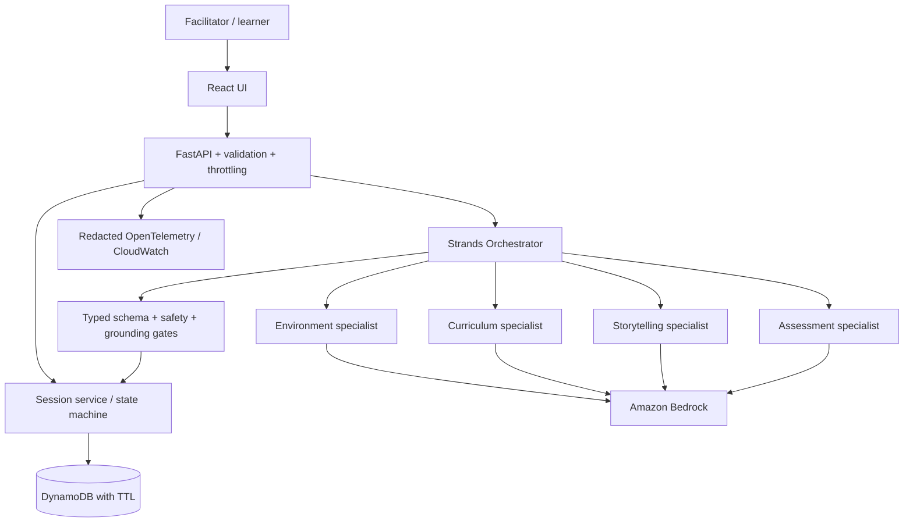
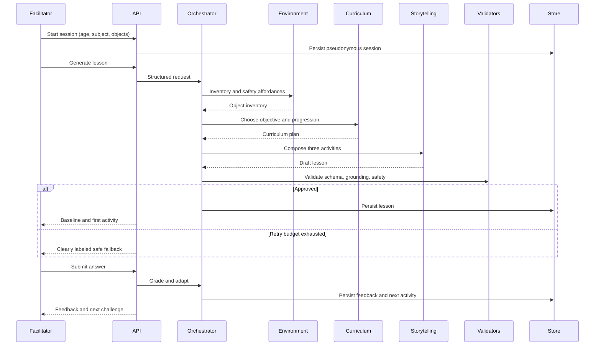
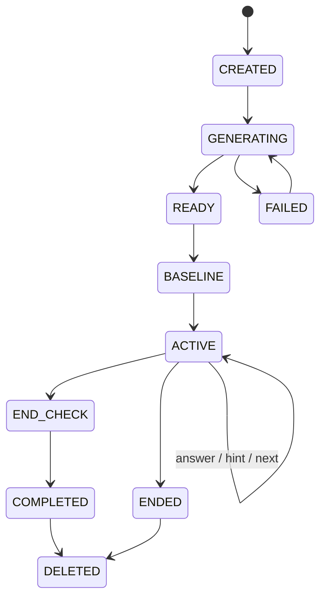

# The Invisible Classroom — Technical Design

**Version:** 1.0 | **Status:** Kiro-ready | **Companion:** `requirements.md`

## 1. Architecture decisions

Build a modular monolith, not microservices. React/TypeScript frontend, Python FastAPI backend, Strands Agents SDK with Amazon Bedrock, DynamoDB short-lived sessions, and container hosting (App Runner or ECS Fargate, subject to account support). Static frontend may use S3/CloudFront. Local development uses an in-memory repository and deterministic model stubs. Mock/demo fallback must never be presented as live agent execution.

Design lenses: AWS Well-Architected, OWASP ASVS/API and LLM Top 10, privacy-by-design, WCAG 2.2 AA, Twelve-Factor configuration. These are engineering guidelines, not certification claims.

Key decisions: adult-mediated access; no child accounts; agents-as-tools with typed handoffs; deterministic arithmetic checks; safety gates outside LLMs; server-owned state; short-lived persistence; explicit model budgets and graceful fallback.

## 2. Component architecture



Use `strands.Agent`, specialist `.as_tool()` wrappers and Pydantic structured outputs, checking exact signatures against the installed, pinned SDK version. Each agent has a narrow system prompt and minimal tools. No unrestricted browser, shell, code execution or external writes.

## 3. Agent responsibilities

| Agent | Input | Output | Constraints |
|---|---|---|---|
| Orchestrator | age, subject, objects, state | approved lesson or assessment | bounded tool calls and deadline |
| Environment | normalized objects | safe object inventory and affordances | never invent required objects |
| Curriculum | inventory, age, subject | objective and three graded challenge intents | age-appropriate, measurable |
| Storytelling | curriculum plan, objects | coherent three-activity adventure | short instructions, rubric, hints |
| Assessment | activity rubric, answer | status, feedback, misconception, scaffold | deterministic grading first |

The orchestration layer performs deterministic validation after every specialist handoff; it does not trust agent output. Safety and grounding gates validate the final lesson and any adapted activity. Retry at most twice, then use a curated safe lesson or return a user-safe error.

## 4. End-to-end sequence



Suggested configurable limits: 45 seconds for generation, 15 seconds for assessment, 8 specialist calls per generation, 2 generation retries, 2 generations per session, bounded tokens and concurrent requests. Validate practical values through live smoke tests; they are not latency guarantees.

## 5. Data contracts

Implement Pydantic v2 contracts in `backend/app/domain/models.py`, expose OpenAPI, and generate frontend TypeScript types. Use strict enums, maximum lengths, schema versions and explicit validation. Example:

```python
from enum import Enum
from pydantic import BaseModel, Field

class AssessmentStatus(str, Enum):
    CORRECT = 'correct'
    PARTIAL = 'partially_correct'
    SUPPORT = 'needs_support'
    UNASSESSABLE = 'unassessable'

class Activity(BaseModel):
    id: str
    instruction: str = Field(min_length=10, max_length=600)
    facilitator_note: str = Field(max_length=600)
    required_objects: list[str] = Field(max_length=8)
    answer_kind: str
    expected_answer: str = Field(max_length=250)
    rubric: str = Field(max_length=500)
    hint: str = Field(max_length=350)
    difficulty: int = Field(ge=1, le=3)

class Lesson(BaseModel):
    schema_version: str = '1.0'
    title: str = Field(max_length=120)
    objective: str = Field(max_length=250)
    available_objects: list[str] = Field(max_length=12)
    activities: list[Activity] = Field(min_length=3, max_length=3)
    baseline_question: Activity
    end_question: Activity
    estimated_minutes: int = Field(ge=5, le=10)

class Assessment(BaseModel):
    status: AssessmentStatus
    explanation: str = Field(max_length=450)
    misconception: str | None = Field(default=None, max_length=250)
    suggested_scaffold: str | None = Field(default=None, max_length=350)
    confidence: float = Field(ge=0, le=1)
```

Also define `CreateSessionRequest`, `ObjectInventory`, `CurriculumPlan`, `SessionState`, `AnswerRequest`, `AgentStageEvent`, `SessionSummary`, `ApiError`. Service validators enforce unique activity IDs, inventory subset, safe actions, valid age and subject, and legal state transitions. Never send `expected_answer` or full rubric to the learner view before answering.

## 6. API and authorization

Prefix `/api/v1`. Session creation returns an opaque ID and a separate high-entropy bearer capability token; store only its hash and require `Authorization: Bearer` for all session-specific routes. Apply CORS origin allowlist, request size limits, per-session/IP throttling and idempotency keys for mutations. No public session listing.

| Method | Endpoint | Function | Requirement |
|---|---|---|---|
| POST | `/sessions` | Create validated session | R-01, R-02 |
| POST | `/sessions/{id}/lessons` | Start idempotent generation; return 202/job status | R-03, R-04 |
| GET | `/sessions/{id}` | Sanitized state and active activity | R-05, R-10 |
| GET | `/sessions/{id}/events` | Poll sanitized specialist stages; SSE optional | R-04, R-12 |
| POST | `/sessions/{id}/answers` | Idempotent assessment | R-06, R-07 |
| POST | `/sessions/{id}/hint` | Scaffold hint | R-05 |
| POST | `/sessions/{id}/advance` | Skip or advance | R-05 |
| POST | `/sessions/{id}/end` | End and prevent further writes | R-08 |
| DELETE | `/sessions/{id}` | Explicit deletion | R-10 |
| GET | `/healthz`, `/readyz` | Runtime status | R-11 |

Return 409 for invalid state, 422 for invalid inputs, 429 for throttling, 503 for unavailable dependencies. Error response includes stable error code, safe message and correlation ID, never raw exception/prompt.

## 7. Session lifecycle and persistence



DynamoDB table `InvisibleClassroomSessions` with partition key `session_id`, `token_hash`, status, age band, subject, object list, approved lesson, responses, current activity index, summaries, created/updated timestamps, `expires_at` TTL and `version` for optimistic concurrency. Conditional writes enforce state transitions. TTL deletion is asynchronous: explicitly delete on request and reject expired reads immediately. No permanent child profile or raw images in MVP. Encrypt at rest and in transit.

## 8. Safety, privacy and threat model

| Risk | Control |
|---|---|
| Unsafe activities | Block fire, blades, electricity, chemicals, ingestion, heights, strangers and dangerous water; curate safe templates; adult supervision |
| Prompt injection | Treat all object descriptions and answers as untrusted data; scoped prompts and tool allowlist |
| Hallucinated resources | Deterministic comparison against approved object inventory |
| Child privacy | No identity fields, redact likely PII, avoid raw prompt/answer logging, 24-hour TTL and delete |
| Session theft | High-entropy capability token, hashed storage, TLS and throttling |
| XSS from model text | Escaped React rendering, CSP, no unsafe raw HTML |
| Runaway cost | Per-session call budgets, deadlines, concurrency limits and idempotency |
| Secrets/supply chain | IAM runtime roles, secret scans, pinned lockfiles, SBOM, dependency scanning |

Avoid claims of certified child safety or proven learning efficacy. Use human-reviewed adversarial cases alongside deterministic checks.

## 9. UX design

Screens: landing/demo preset; session setup; sanitized agent timeline; baseline check; one activity at a time; hint and feedback; adapted activity; end check; provisional summary and delete. Responsive from 320px; accessible focus, semantic labels, `aria-live` for feedback, adequate contrast, reduced motion, no timed answers. Separate learner-facing content from facilitator-only notes.

## 10. Project structure

```text
invisible-classroom/
  .kiro/specs/invisible-classroom/{requirements.md,design.md,tasks.md}
  frontend/src/{app,components,features,api,types}/
  frontend/tests/
  backend/app/main.py
  backend/app/api/routes/
  backend/app/domain/{models.py,state_machine.py}
  backend/app/agents/{orchestrator.py,environment.py,curriculum.py,storytelling.py,assessment.py}
  backend/app/services/{lesson_service.py,assessment_service.py,safety.py,grounding.py}
  backend/app/adapters/{bedrock.py,session_store.py}
  backend/app/templates/safe_lessons/
  backend/app/observability/
  backend/tests/{unit,integration,evals}/
  infra/
  scripts/seed_demo.py
  docs/{demo-script.md,threat-model.md}
  .github/workflows/ci.yml
  README.md
```

Use dependency injection for model/store/clock; version system prompts. Select one IaC tool (CDK or Terraform) and document why. Use Ruff, mypy, pytest, ESLint, TypeScript checking, Vitest, Playwright, axe, vulnerability and secret scans.

## 11. Testing and evaluation

**Unit:** normalization, grounding, safety taxonomy, typed schemas, state transitions, exact grading, adaptation, redaction, idempotency. **Integration:** stubbed specialist calls, malformed outputs, timeout/429, DynamoDB conditional updates, expired capability. **E2E:** demo preset -> baseline -> incorrect answer -> hint -> adapted challenge -> end check -> summary -> deletion. Keyboard-only and 320px viewport checks.

Build >=30 synthetic evaluation cases across age bands, objects, ambiguous inputs, unsafe requests and misconception patterns. Track schema pass, grounding, safety, objective suitability, adaptation, latency and usage. Keep qualitative human-reviewed scores distinct from automated assertions. Target >=90% valid/safe generated cases, >=90% relevant scripted adaptation, >=95% completion over 20 controlled runs; these are targets, not measured facts.

## 12. Deployment, observability and cost

Configure Bedrock model/region via environment; verify access, pricing and quotas. Run API with an IAM role limited to required Bedrock invocation, DynamoDB table and CloudWatch writes. Log redacted correlation IDs and sanitized specialist-stage spans; monitor errors, p50/p95 latency, fallback rate, model calls and estimated cost. Configure budgets/alerts where available. CI: lint/typecheck -> unit -> security -> build -> integration -> E2E smoke. Live-model tests are opt-in and mandatory for pre-demo verification. Provide `.env.example`, local mock mode, deployment and cleanup instructions.

## 13. Implementation sequence for Kiro-generated tasks

1. Foundation: repo, typed models, configuration, tests, CI (R-01, NFR-02/06/07).
2. Sessions: form, API, capability authorization, TTL/delete (R-01, R-02, R-10).
3. Strands: specialists, orchestration, Bedrock adapter and structured contracts (R-03, R-04).
4. Safety: grounding, bounded retries, safe fallback (R-02, R-03, R-08, R-11).
5. Learning loop: baseline, three activities, deterministic/model assessment, adaptation, summary (R-05–R-07).
6. Demo hardening: accessibility, sanitized stage timeline, seed data, evaluation, documentation (R-09, R-12).
7. Stretch only: photo input and Hindi support (R-13, R-14).

Every generated task SHALL cite requirement IDs, describe a testable completion condition, identify dependencies, and avoid mixing P1/P2 work into P0 critical path.

## 14. Three-minute demo storyboard

0:00–0:20 problem and social impact; 0:20–0:40 select synthetic demo preset; 0:40–1:15 show real specialist execution and generated object-grounded adventure; 1:15–1:55 submit a wrong answer, show supportive feedback and adapted next activity; 1:55–2:25 show baseline/end check and provisional summary; 2:25–2:50 show safety/grounding checks, AWS/Strands architecture and measured run metadata; 2:50–3:00 close on accessibility and limitations. Have a clearly labeled deterministic fallback ready if cloud inference fails.

## 15. Requirement-to-component mapping

| Requirements | Primary modules |
|---|---|
| R-01, R-02 | Setup UI, session API, environment normalization |
| R-03, R-04 | Orchestrator, specialists, schema/grounding validators |
| R-05–R-07 | Activity UI, assessment service, state machine |
| R-08, R-09 | Safety service, accessible frontend |
| R-10, R-11 | Session repository, authorization, observability |
| R-12 | Demo preset, sanitized trace, test fixtures |
| R-13, R-14 | Optional multimodal/language adapters |

## 16. References

- Kiro requirements-first: https://kiro.dev/docs/specs/feature-specs/requirements-first/
- Strands agents-as-tools: https://strandsagents.com/docs/user-guide/sdk/multi-agent/agents-as-tools/
- Strands structured outputs: https://strandsagents.com/docs/user-guide/sdk/agents/structured-output/
- AWS Well-Architected: https://aws.amazon.com/architecture/well-architected/
- OWASP LLM Top 10: https://genai.owasp.org/llm-top-10/
